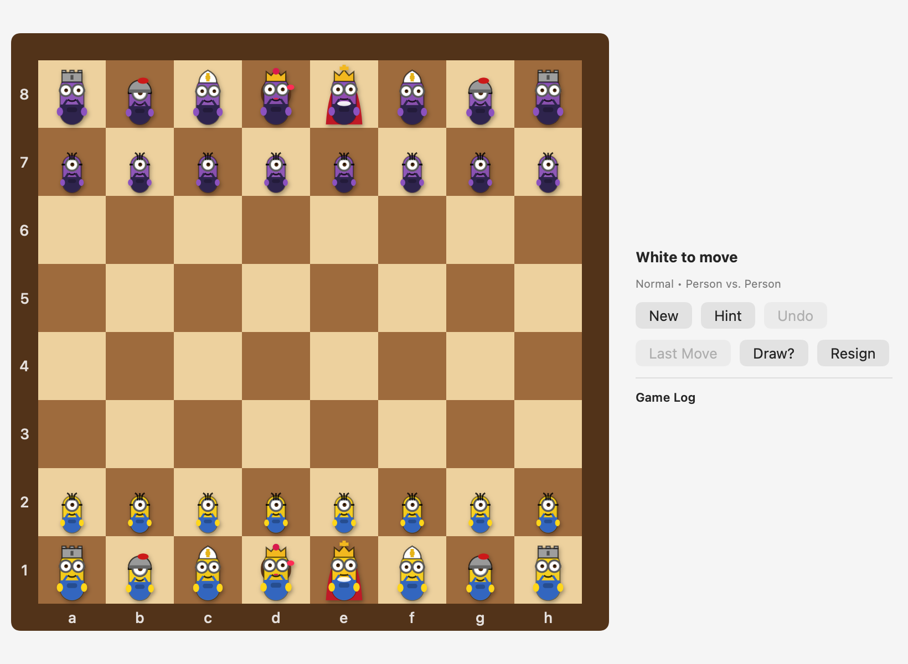
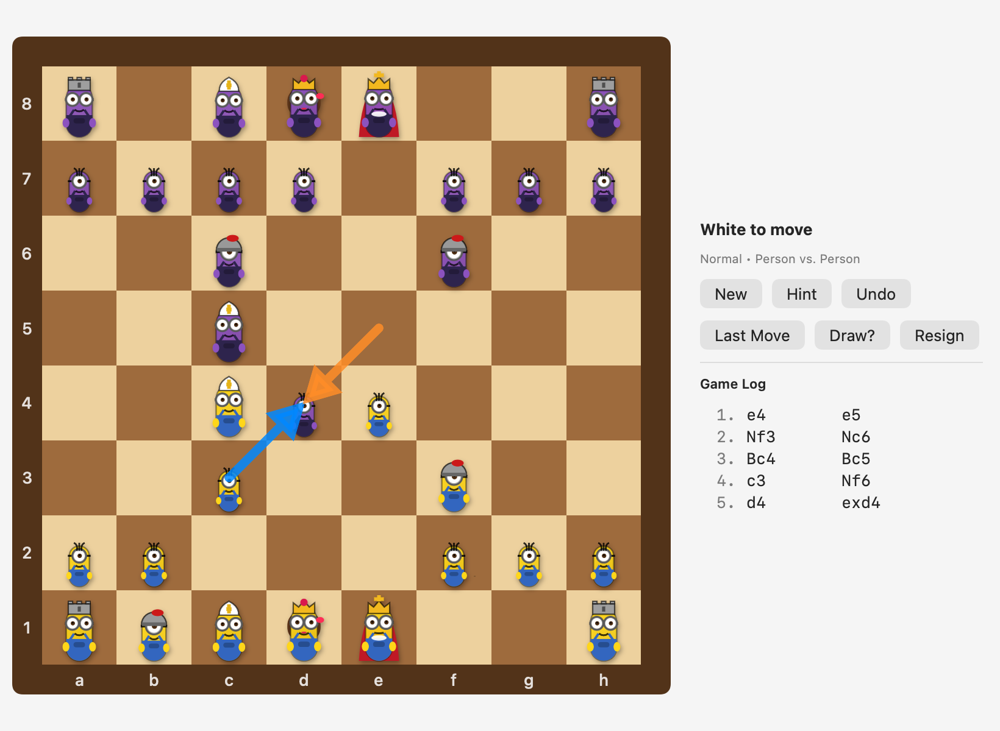
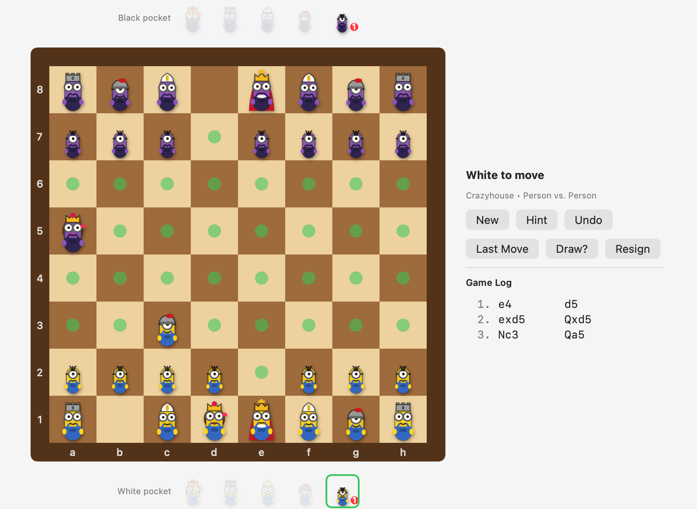

# Minion Chess

A native macOS chess app where every piece is a minion-style character. Original engine and original vector art.
See [FEATURES.md](FEATURES.md) for everything it does.

## Screenshots

## Download and play
1. Download `Minion-Chess-1.0.0-macOS.zip` from the Releases page and unzip it.
2. Drag **Minion Chess.app** to Applications.
3. The app is not notarized. On first launch, right-click it, choose **Open**, then confirm. If macOS still refuses, run:
   `xattr -cr "/Applications/Minion Chess.app"`

Requires macOS 13 or later (Apple silicon and Intel).

## Build from source
`./build_app.sh` (needs Xcode command line tools). Rules self-test: `MinionChess --selftest`.
